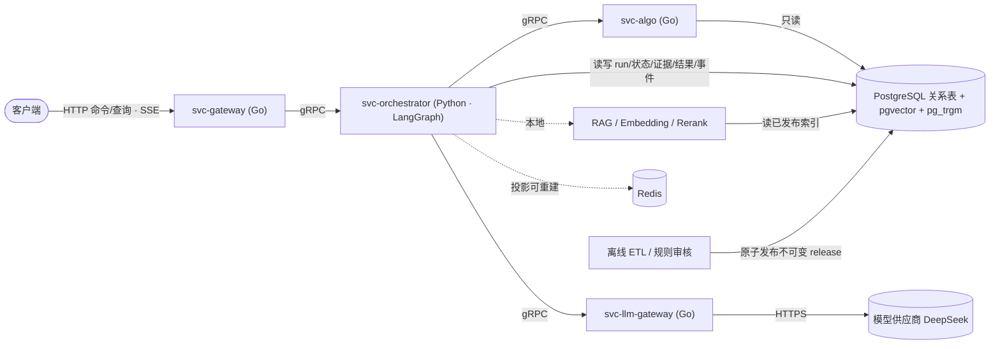
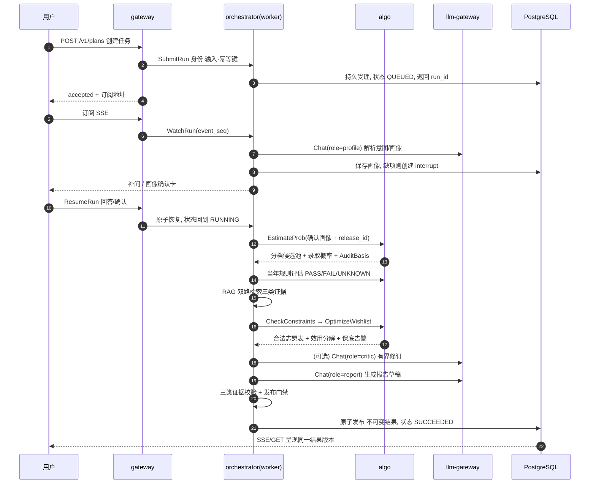
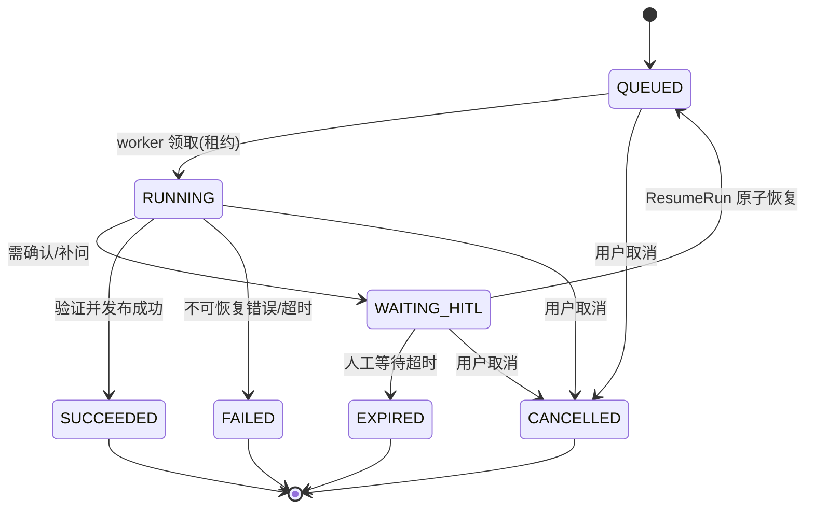
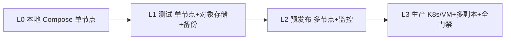

# 架构总览 · 高考志愿智能决策 Agent 系统

> ⚠️ **派生视图，非权威。** 本文是 [PRD v1.3](./prd.md) 的可视化总览，便于快速理解系统「做成什么样」。
> **全部结论以 `docs/prd.md`（v1.3，目标态唯一权威）为准**；代码现状见 [gap-analysis.md](./gap-analysis.md)，决策理由见 [docs/adr/](./adr/)。若本文与 PRD 冲突，以 PRD 为准。
>
> 源文件：`docs/agent-architecture.md`（本文件）｜渲染产物：`agent-architecture.html`｜生成日期：2026-11-18。

---

## 1. 系统定位与边界

把考生自然语言画像转化为**权威、可解释、可复核**的高考志愿决策结果。LLM 只负责语义抽取与生成，**数值计算一律交给确定性算法（svc-algo）**。MVP 仅服务**湖南省新高考 3+1+2**。

| 本期做 | 本期不做 |
| --- | --- |
| 自然语言转结构化画像并确认 | 其他省份 |
| 院校/专业双维筛选，生成冲/稳/保候选池 | 旧高考、物理历史混算 |
| 当年规则评估（资格/选科/体检/单科等） | 直接承诺录取 |
| 约束校验 + 多目标优化排序出志愿表 | 人工代填志愿 |
| 报告生成，三类证据 100% 溯源 | 无证据的数值生成 |
| 任务级断点续跑 + HITL 确认 | 永久免费/无预算治理 |

> 对应 PRD §1.2 / §4。核心原则「LLM 管语义、代码管数值」见 PRD §1.3。

---

## 2. 四服务拓扑与数据所有权

**单向 DAG，禁止任何反向或跨层依赖**：`gateway → orchestrator → { llm-gateway, algo }`；`algo → 发布数据/规则`；`orchestrator → RAG → 已发布索引`。

| 服务/模块 | 拥有并保证 | **不得承担** | PRD |
| --- | --- | --- | --- |
| svc-gateway | 身份、命令入口、订阅投影 | 不生成业务事件、不持久业务权威状态、不做志愿编排 | §8.3 |
| svc-orchestrator | run/interrupt/检查点/候选/证据/结果/事件的**唯一业务写入方** | 不自算概率·位次·约束·效用、不直连大模型、不在内存隐式保存任务 | §8.3 |
| svc-algo | 可复现数值与规则结果（概率/转换/约束/优化 + AuditBasis） | 不调用 LLM、不决定补问或发布 | §8.3 |
| svc-llm-gateway | 供应商适配、缓存、预占/结算、内容安全 | 不理解志愿业务、不生成最终数值结论 | §8.3 |
| RAG 模块 | 检索召回、rerank、证据投影 | 不修改业务结果、不改写规则文本 | §8.3 |
| 离线 ETL | 原始采集、清洗、哈希、规则审核、发布门禁 | 不直接服务在线请求 | §8.3 |

> PostgreSQL「一库三用」（关系表 + pgvector + pg_trgm）；Redis 投影可由 PG 重建。详见 PRD §8.1 / §8.3。

---

## 3. 端到端时序（15 步主干）

> 与 PRD §5.2 一致；下图为主干，按需补问/回算/有界修订等分支见 PRD §8.6。

**数据流转（PRD §5.1）**：自然语言 → 结构化画像 →（+分数/位次）→ 检索证据 → 候选池 → 合法志愿表 → 可溯源报告。

---

## 4. run 生命周期状态机

- **恢复入口**：`POST /v1/runs/{run_id}:resume`；回答/确认必须**原子**完成「消费 interrupt + 保存命令 + 转回 QUEUED」，worker 再从持久 checkpoint 应用一次回答。
- **过期不原地复活**：`EXPIRED` 的是 run，可在同一 session 派生新 run；历史 run 不可变。
- 状态机与门禁详见 PRD §6.2 / FR-06。

---

## 5. 治理与红线

| 机制 | 要点 | PRD |
| --- | --- | --- |
| 任务级状态 | run/interrupt/state_version/profile_version/release_id；检查点用官方 `langgraph-checkpoint-postgres` | §6.2 / §8.4 / [ADR-0002](./adr/0002-langgraph-official-postgres-saver.md) |
| 权威状态 | PostgreSQL 是 run/事件/结果唯一权威；Redis 仅投影可重建 | §8.1 / §8.3 |
| 数据版本 | 不可变 `release` 表（内容哈希），`data_version` 过渡保留 | §8.4 / [ADR-0004](./adr/0004-immutable-content-hash-release-id.md) |
| Budget Guard | **原子预占 + 按实际 usage 结算**；同一 `principal + session` 跨 run 累计 ≤50K token / $0.15，超限只返回已验证结果或失败 | FR-20 |
| 图控制权 | 归 orchestrator；补问必须创建 interrupt，禁止业务节点返回终态冒充补问 | §8.3 / FR-06 |
| 循环上限 | 补问 ≤6 / Critic ≤2 / 报告重写 ≤2 / 候选回算 ≤2 | §5.2 / FR-16 |
| 发布门禁 | 缺证据/规则 UNKNOWN/数值越界 → 阻断或显式 `BLOCKED_*`，不生成成功结果 | FR-19 |
| 三类证据 | 文档事实 / 结构化事实 / 算法派生事实，均可溯源到发布版本（policy_* 为活表，见 [ADR-0006](./adr/0006-consolidate-policy-tables-drop-charter.md)） | §8.5 |

> 8 条全局红线见 `AGENTS.md`「全局红线」节。

---

## 6. 里程碑与部署阶梯

| 阶段 | 里程碑 | 目标（浓缩） |
| --- | --- | --- |
| A | M1 | 规格对齐：主链、画像/任务/事件 schema、proto/DB 与发布门禁定型 |
| B | M2 | 可靠任务底座：持久受理、官方 saver、interrupt、恢复、租约和 SSE |
| C | M3 | 受控 ALGORITHM_PREVIEW：确认画像 → 四 RPC → 可审计结构化结果 |
| D | M4 | 生产资格与证据：检索、规则链、三类证据和 release 读取 |
| E | M5 | 模型治理与表达：llm-gateway、报告、失败模板和评测门禁 |
| F | M6 | P1 智能增强：Strategy/Critic、政策问答、解释修订和可观测性 |

> 里程碑详情见 PRD §9；部署阶梯见 PRD §8.1 / §10。

---

## 7. 权威来源指向

| 要了解 | 去哪 |
| --- | --- |
| 目标态全部结论（需求/流程/契约/验收） | [docs/prd.md](./prd.md) v1.3 —— **唯一权威** |
| 代码现状与差距（活文档） | [docs/gap-analysis.md](./gap-analysis.md) |
| 关键决策理由 | [docs/adr/](./adr/) 0001~0006 |
| 术语唯一定义 | [GLOSSARY.md](../GLOSSARY.md) |
| 每次会话入口 / 红线 | [AGENTS.md](../AGENTS.md) |
| 历史审查（存档，不再维护） | [docs/agent-architecture-review.md](./agent-architecture-review.md) |
